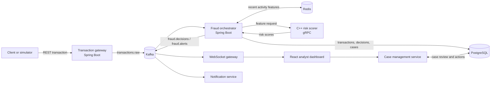

# Low-Latency Fraud Engine

An event-driven fraud detection prototype that evaluates transaction activity, records risk decisions, and streams suspicious events to an analyst dashboard.

The project brings together Kafka, Redis, Spring Boot, a C++ gRPC scoring service, PostgreSQL, WebSockets, and React. It is designed as an end-to-end system you can run locally and inspect—not as a production payment processor.

## The problem

A single payment can look normal on its own while a sequence of payments is suspicious. For example, a card may suddenly make many purchases in a short period, use a new device, or spend an amount far outside the account's recent pattern. If a system only looks at transactions one at a time, it can miss that context. If it reacts too late, an analyst may find out after more transactions have already happened.

A useful fraud detection flow needs to do several things together:

- accept transactions quickly without making the caller wait for every downstream step;
- consider recent activity as well as the current transaction;
- produce a clear decision and preserve an audit trail;
- surface suspicious activity to an analyst for investigation.

## A simple example

Suppose Shiv usually makes a few small purchases from the same phone. Within seconds, several more payments arrive for Shiv from that device. Each payment might look plausible alone, but the burst is unusual as a group. A detector that tracks recent transaction velocity can raise the risk, save the decision, and notify the review dashboard.

This repository demonstrates that flow with generated and manually submitted transactions. It does not connect to a bank or stop a real payment.

## How this project solves it

1. **Accept:** the transaction gateway validates a request and publishes it to Kafka. The API returns `202 Accepted`; processing continues asynchronously.
2. **Add context:** the fraud orchestrator reads recent user activity from Redis and builds features such as transaction velocity, amount deviation, device and location risk, and merchant diversity.
3. **Score:** the orchestrator sends those features to a C++ service over gRPC. The current scorer combines hand-written heuristics into a risk score; it is not a trained machine-learning model.
4. **Decide and persist:** the orchestrator records the transaction and its decision in PostgreSQL. Suspicious decisions become reviewable cases.
5. **Publish and display:** decisions and alerts are published through Kafka. The WebSocket gateway streams live updates to the React dashboard, where an analyst can inspect and resolve a case.

The separation between ingestion, scoring, storage, and display makes each part easier to inspect and lets the event pipeline process work asynchronously.

## Architecture



### Main components

| Component | Responsibility |
| --- | --- |
| Transaction gateway | REST ingestion, validation, demo login, and Kafka publishing |
| Kafka | Buffers and distributes transaction, decision, and alert events |
| Fraud orchestrator | Builds features, calls the scorer, stores decisions, and emits events |
| Redis | Keeps recent activity used for rolling features |
| C++ gRPC scorer | Computes a heuristic risk score from normalized features |
| PostgreSQL | Stores transactions, decisions, and cases for audit and review |
| Case management | Retrieves cases and records analyst actions |
| Notification service | Maintains a recent alert inbox |
| WebSocket gateway and React dashboard | Deliver and display live decisions, alerts, and case activity |

## Detection approach

The scoring service combines several signals rather than treating one value as proof of fraud:

- **Velocity:** how frequently the user has transacted recently.
- **Amount anomaly:** how the current amount compares with recent spending features.
- **Device and location risk:** risk values supplied for the transaction context.
- **Merchant diversity:** changes in the set of recent merchants.

These signals feed a weighted heuristic ensemble and a fraud probability. The surrounding service turns the score into an `ALLOW`, `REVIEW`, or `BLOCK` decision and persists it for review. This is a transparent prototype baseline. It has no trained model, labeled-data evaluation, or production calibration, so its scores should not be treated as real-world fraud probabilities.

## Run the project

### Option 1: Run the full stack with Docker Compose

Install Docker with the Compose plugin, then run these commands from the repository root:

```bash
docker compose up --build -d
docker compose ps
docker compose logs --tail=100
```

The first build downloads dependencies and can take several minutes. Kafka runs in KRaft mode; ZooKeeper is not required. When the services are ready, open **http://localhost:5173** and submit transactions from the dashboard.

Stop the containers with:

```bash
docker compose down
```

PostgreSQL data is kept in a Docker volume. To remove the containers and that data, use `docker compose down -v`.

### Option 2: Run applications on your host

You need Kafka, Redis, and PostgreSQL available, plus JDK 17, Maven, Node.js 20+, CMake, a C++17 compiler, protobuf, and gRPC development tools. Start the infrastructure with Docker:

```bash
docker compose up -d kafka redis postgres kafka-init
```

Then install/build and start the applications:

```bash
cmake -S . -B build -DCMAKE_BUILD_TYPE=Release
cmake --build build -j2
mvn package
npm --prefix websocket-gateway ci
npm --prefix dashboard ci
npm --prefix simulator ci
bash scripts/run-local.sh
```

The launcher starts the C++ scorer, Java services, WebSocket gateway, and dashboard. It does not start or stop infrastructure. See [run-without-docker.md](run-without-docker.md) for a fully native setup, environment variables, and troubleshooting.

### Local service ports

| Service | Port |
| --- | ---: |
| Dashboard | 5173 |
| Transaction gateway | 8080 |
| Fraud orchestrator | 8081 |
| Case management | 8082 |
| Notification service | 8083 |
| WebSocket gateway | 3001 |
| C++ gRPC scorer | 50051 |
| Kafka | 9092 |
| Redis | 6380 on host |
| PostgreSQL | 5433 on host |

## Try it

The local sandbox endpoint accepts a transaction without a login and sends it through the same asynchronous scoring pipeline:

```bash
curl -i http://localhost:8080/api/v1/sandbox/ingest \
  -H 'Content-Type: application/json' \
  -d '{
    "user_id": "shiv",
    "amount": 5000,
    "currency": "INR",
    "merchant_id": "shop-1",
    "location": "Chennai",
    "device_id": "phone-1",
    "channel": "ONLINE"
  }'
```

Ingestion responds with `202 Accepted`, which means the request was accepted for asynchronous processing. View the eventual decision in the dashboard or query the recent decisions endpoint at `http://localhost:3001/api/recent-decisions`.

To generate sample traffic:

```bash
node simulator/simulator.js --mode demo
node simulator/simulator.js --mode burst
```

The burst mode is useful for observing how repeated activity changes decisions. The smoke test exercises the live pipeline, including a blocked burst, a persisted case, analyst resolution, and notification delivery. It creates seven test transactions and leaves their records in the database:

```bash
node scripts/smoke-test.mjs
```

## Example: Shiv's transaction burst

Shiv normally uses a phone to make occasional purchases. During a test, seven `₹100` online transactions arrive for Shiv in quick succession from the same device, merchant, and Chennai location. Considered individually, each amount is small. Considered together, the sudden transaction velocity is unusual.

Here is what happens in the project:

1. The gateway accepts each transaction and publishes it to `transactions.raw`.
2. The orchestrator checks Shiv's recent activity in Redis and sends the resulting features to the C++ scorer.
3. The scorer weighs velocity alongside amount, device, location, and merchant signals.
4. The orchestrator saves the decisions in PostgreSQL and publishes a fraud alert for a blocked transaction.
5. The dashboard receives the live alert; an analyst can open its case and resolve it.

The end-to-end smoke test uses this seven-transaction burst and confirms that the real Kafka/Redis/C++ path produces an `ALLOW` for ordinary activity and a `BLOCK` for the burst, with a corresponding case and alert.

## Project status and limitations

- This is a local development and demonstration system, not a production deployment.
- The scorer is a hand-written heuristic ensemble, not a trained or calibrated ML model.
- Sub-20 ms latency and million-transaction throughput are design goals, not verified benchmarks.
- A `BLOCK` is a recorded decision; no bank, card network, or payment processor is connected.
- Demo credentials, the unauthenticated sandbox endpoint, plaintext service traffic, and the Vite development server are not production security settings.
- Kafka and PostgreSQL writes are not an exactly-once transaction. The `fraud.dlq` topic exists, but no dead-letter handler is configured.

## Technologies

**C++17 · gRPC · Protocol Buffers · Java 17 · Spring Boot · Apache Kafka · Redis · PostgreSQL · Node.js · Express · WebSockets · React · Vite · Docker Compose**
